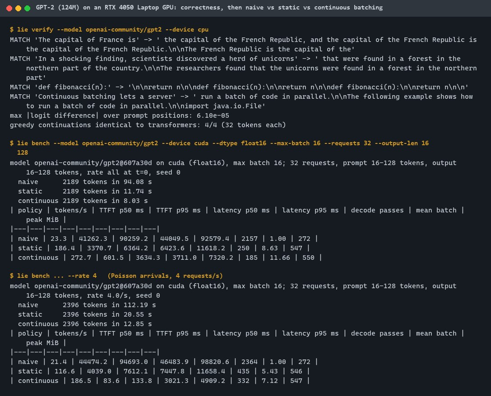
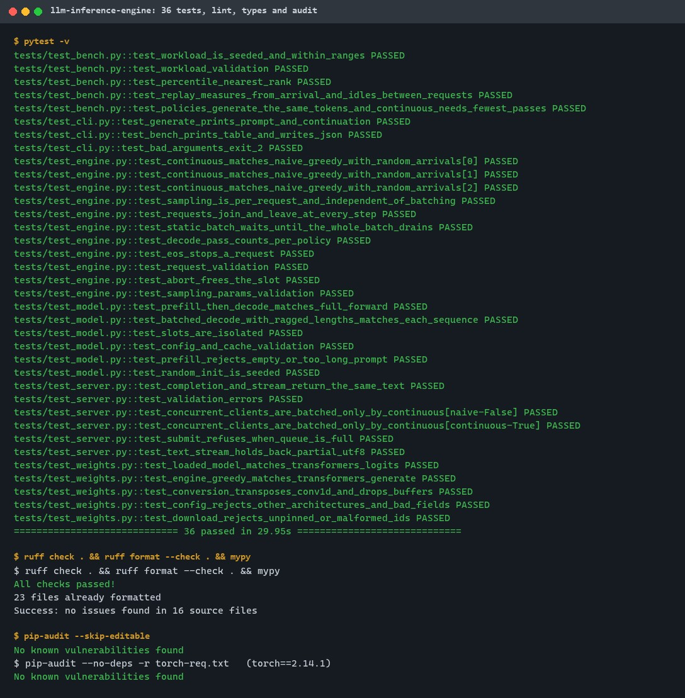
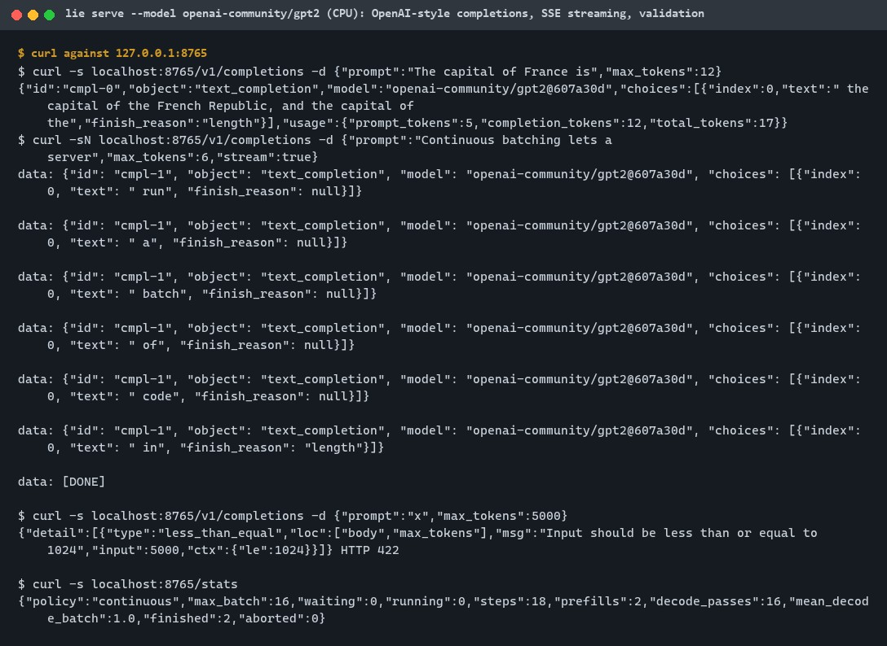
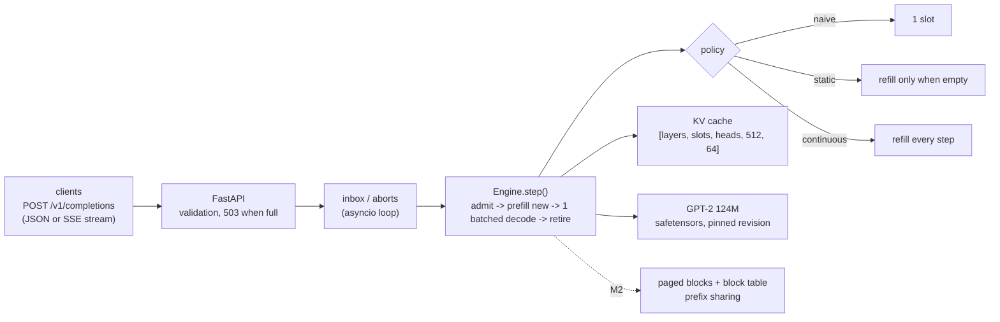
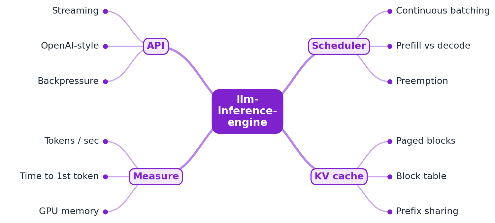
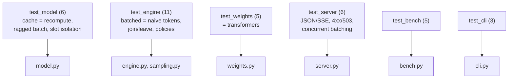

# llm-inference-engine

[](https://github.com/EquinoxWN/llm-inference-engine/actions/workflows/ci.yml)


> Why serving an LLM is expensive, and how to make it cheaper, step one: a GPT-2 serving engine in PyTorch where continuous batching gives 11.7x the throughput of a one-request-at-a-time server on a laptop GPU (272.7 vs 23.3 tokens/s).

Part of my **AI and Machine Learning** list · Python

## Proof it works

On GPT-2 (124M, float16, RTX 4050 Laptop GPU), the same 32 requests run through three schedulers on
the same engine. Continuous batching generates 272.7 tokens/s against 186.4 for static batching and
23.3 for the naive server, and under 4 requests/s it serves the first token in 84 ms (p50) where
static batching takes 4.0 s. The engine's logits match `transformers` to 6.1e-05 and its greedy
output is identical:



36 tests pass (batched output equals naive output on random arrival schedules, KV-cache decode
equals a full recompute, weights equal `transformers`), lint and types are clean, and the
dependency audit finds nothing:



The OpenAI-style API serving GPT-2, with streaming and input validation:



## Architecture

**What M1 runs today:**



**Full roadmap (M1 to M3):**



## How it works

_Steps 1 and 2 are built and measured; the rest is on the [roadmap](#roadmap)._

1. A naive server handles one request at a time to set the baseline.
2. Continuous batching adds and removes requests at every decoding step instead of waiting for a whole batch to finish.
3. The KV cache is split into fixed-size blocks tracked by a block table (as in PagedAttention), so memory isn't wasted on padding.
4. Requests sharing a prompt prefix reuse the same cached blocks.
5. When memory runs out, the scheduler preempts low-priority requests and resumes them later.
6. Throughput, time-to-first-token and memory are compared with the naive server and with vLLM on the same model.

In M1 one engine runs all three schedulers: `naive` (one slot), `static` (a new batch only when
the previous one has drained) and `continuous` (free slots are refilled at every step). Each step
prefills newly admitted prompts, then advances every running sequence by one token in a single
batched forward pass that writes each sequence's keys and values at its own position in its own
cache slot. Sampling uses a generator seeded per request, so batching never changes a request's
tokens.

## Who it helps

- **Who:** engineers who run or evaluate LLM serving stacks (vLLM, SGLang, TGI) and want to see what iteration-level scheduling does before tuning one.
- **The problem:** throughput and latency numbers from a serving stack are hard to interpret without a baseline; here the naive, static and continuous schedulers share one model and one KV cache, so the measured difference is the scheduler alone.
- **How to use it:** run `lie bench` on your GPU with your own request mix (prompt and output length ranges, arrival rate) to see tokens/s, TTFT, latency and memory per policy, or `lie serve` to get a small OpenAI-style completions endpoint for GPT-2 checkpoints.
- **For learning:** about 1,300 lines of typed Python with tests that pin down each claim (KV-cache decode equals recompute, batched output equals naive output).

## Tech stack

| Area | In M1 | Planned |
|---|---|---|
| Model | GPT-2 (124M) written against an explicit KV cache, weights from safetensors at a pinned revision, PyTorch SDPA attention | Larger open-weight models (1-3B) |
| Scheduler | naive, static and continuous batching; per-request seeded sampling | Paged KV cache, prefix sharing, preemption |
| API | FastAPI `/v1/completions` (JSON and SSE streaming), bounded queue | Priorities, backpressure by memory |
| Bench | Seeded load generator: tokens/s, TTFT, latency, decode passes, peak GPU memory | vLLM on the same model and workload |

Language: **Python** (3.11+, PyTorch). Code in [`src/llm_inference_engine/`](src/llm_inference_engine): `model.py` (GPT-2 with prefill/decode over a slot KV cache), `engine.py` (scheduler and policies), `sampling.py`, `weights.py` (pinned download, strict load), `tokenizer.py`, `server.py` (API), `bench.py` (load generator), `cli.py` (`lie`).

## Run it

**Prerequisites:** Python 3.11+. Tests run on a CPU; the GPU benchmark needs an NVIDIA GPU with a CUDA 13 driver.

```bash
python -m venv .venv && source .venv/bin/activate   # Windows: .venv\Scripts\activate
make setup       # CPU PyTorch + package + dev tools   (make setup-cuda for the CUDA 13.0 build)
make lint        # ruff, ruff format, mypy --strict
make test        # 36 tests on a tiny random model, no download
make audit       # pip-audit (PyTorch audited by its PyPI version)
make verify      # download GPT-2 (rev 607a30d) and compare logits and greedy output with transformers
make bench-gpu   # naive vs static vs continuous on GPT-2, float16, CUDA
make serve       # API on 127.0.0.1:8000
```

```bash
curl -s localhost:8000/v1/completions -H 'content-type: application/json' \
  -d '{"prompt": "The capital of France is", "max_tokens": 12}'
```

`lie bench --help` lists the workload options (`--requests`, `--prompt-len`, `--output-len`,
`--rate`, `--seed`, `--max-batch`). The model is downloaded into `.tmp/hf`; delete it when done.

## Tests and results

Full numbers, the analysis and how to reproduce them: [docs/results/m1.md](docs/results/m1.md).

| Test file | Tests | What it proves |
|---|---|---|
| `tests/test_model.py` | 6 | KV-cache prefill + decode equals a full recompute; one batched decode over ragged lengths equals each sequence alone; slots are isolated; shape validation |
| `tests/test_engine.py` | 11 | Continuous batching gives the naive server's exact tokens on random arrival schedules (greedy and seeded sampling); requests join the step after another leaves; static batching makes late requests wait; decode passes continuous < static < naive; EOS, validation, abort |
| `tests/test_weights.py` | 5 | GPT-2 weights load strictly and match `transformers` logits and `generate()`; unpinned revisions and malformed ids refused |
| `tests/test_server.py` | 6 | JSON and SSE completions agree; 422/400 on bad input; concurrent clients share decode passes only under `continuous`; full queue refused; partial UTF-8 held back |
| `tests/test_bench.py` | 5 | Seeded workloads; TTFT measured from arrival (fake clock); all policies generate the same tokens |
| `tests/test_cli.py` | 3 | `lie generate` and `lie bench` end to end; bad arguments exit 2 |

| Check | Result |
|---|---|
| Tests (`make test`) | **36 passed**, 0 failed |
| GPT-2 vs `transformers` (`make verify`) | max logit difference 6.1e-05; greedy output identical 4/4 (32 tokens each) |
| Throughput, 32 queued requests, GPT-2 fp16 on RTX 4050 | naive 23.3, static 186.4, **continuous 272.7** tokens/s |
| TTFT p50 at 4 requests/s | naive 44.5 s, static 4.0 s, **continuous 84 ms** |
| Decode passes for the same 2,189 tokens | naive 2157, static 250, continuous 185 (mean batch 11.7) |
| Peak GPU memory | 272 MiB with 1 slot, 550 MiB with 16 slots (288 MiB of it reserved KV cache) |
| Lint / audit | ruff, mypy `--strict` clean; `pip-audit`: no known vulnerabilities |

### Test map



## Roadmap

**M1** (≈8 h)
- [x] Write `docs/rfc/0001-design.md`: problem, goals, non-goals, chosen design
- [x] A naive server handles one request at a time to set the baseline.
- [x] Continuous batching adds and removes requests at every decoding step instead of waiting for a whole batch to finish.
- [x] CI workflow (`ci` with tests, audit and tiny-model benchmark; `gpt2` verify job): green in CI; GPT-2 greedy output identical to transformers on 4/4 prompts.

**M2** (≈8 h)
- [ ] The KV cache is split into fixed-size blocks tracked by a block table (as in PagedAttention), so memory isn't wasted on padding.
- [ ] Requests sharing a prompt prefix reuse the same cached blocks.

**M3** (≈9 h)
- [ ] When memory runs out, the scheduler preempts low-priority requests and resumes them later.
- [ ] Throughput, time-to-first-token and memory are compared with the naive server and with vLLM on the same model.
- [ ] Publish the proof below with real numbers

## Proof

What this repo must show before it counts as done:

- Throughput and latency charts vs naive and vLLM, with an honest gap analysis.

| Result | Value |
|---|---|
| M3 proof above (vLLM comparison) | Not measured yet (M3). Current M1 numbers against the naive server: see [Tests and results](#tests-and-results). |

## Why it matters

- **Interview angle:** 'Design an LLM serving platform', increasingly common in ML-infrastructure loops.
- **Upstream I'd like to contribute to:** vLLM or SGLang: tests, docs or small fixes.

## Design docs

- [RFC 0001: design](docs/rfc/0001-design.md)
- [ADR 0001: record architecture decisions](docs/adr/0001-record-architecture-decisions.md)
- [ADR 0002: slot-based KV cache with iteration-level scheduling](docs/adr/0002-slot-kv-cache-and-iteration-level-scheduling.md)
- [M1 results](docs/results/m1.md)

## Scope

This is a learning and portfolio system, not a hosted production service. Everything runs locally;
the server binds to 127.0.0.1 and has no authentication.

## Security and contributing

- Every GitHub Action is pinned to a commit SHA; workflows run read-only, without persisted credentials.
- Dependabot update pull requests are paused (`open-pull-requests-limit: 0`) so the repository keeps a single `main` branch; dependencies are updated by hand and checked by the CI audit.
- Request bodies are validated and bounded, the waiting queue is capped (HTTP 503), and checkpoints load only by a full commit hash from safetensors with a strict state-dict check.
- Report vulnerabilities privately: see [SECURITY.md](SECURITY.md). To contribute, see [CONTRIBUTING.md](CONTRIBUTING.md).

## License

MIT, see [LICENSE](LICENSE).
